<div align="center">

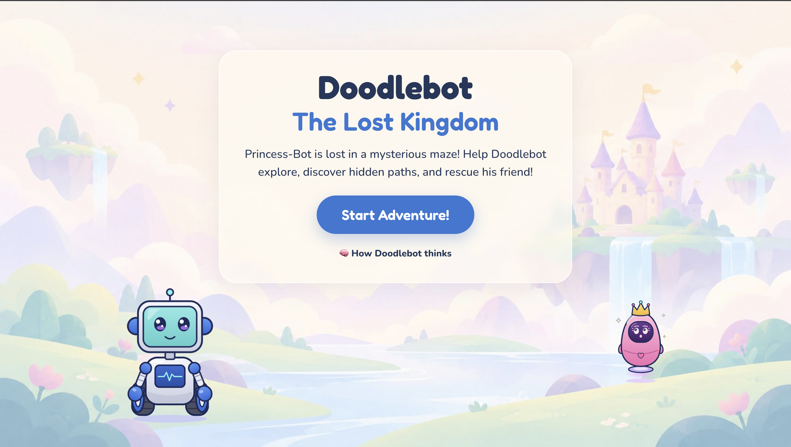

# 🤖 Doodlebot – The Lost Kingdom

**A web game that teaches Grade 5 students how a robot finds its way through a world it cannot see.**

Doodlebot **senses** what is around it, **builds its own map**, and only then **plans** the shortest path to rescue Princess-Bot. 👑

[](https://doodlebot-navigator.onrender.com/#welcome)
&nbsp;

&nbsp;

&nbsp;


</div>

---
## 🎥 Watch the 3-minute demo

▶️ **[Watch the demo video](https://drive.google.com/file/d/1T7JMBFbPlQV1pepTCgWxajuwD3P79AD4/view?usp=sharing)**: building a maze, exploration, planning, the sensor experiment and a voice chat with Doodlebot.

## 🔗 Quick links

| 🎮 Game | 📚 Lesson (Grade 5, 30 min) | 📝 Write-ups |
|---|---|---|
| [**Play online**](https://doodlebot-navigator.onrender.com/#welcome) | [Lesson plan (PDF)](curriculum/Doodlebot_Lesson_Plan.pdf) | [Design reflection (1 page)](docs/Doodlebot_Design_Reflection.pdf) |
| [Run it locally](#-run-it-locally) | [Lesson slides (PPTX)](curriculum/Doodlebot_Lesson_Slides.pptx) | [Design report (how I built it)](docs/Doodlebot_Design_Report.pdf) |
| [Doodlebot's chat prompt](prompts/doodlebot.md) | [Student worksheet (PDF)](curriculum/Doodlebot_Student_Worksheet.pdf) | [Character design](CHARACTER_DESIGN.md) |
| [**Play online**](https://doodlebot-navigator.onrender.com/#welcome) | ...
> ⏳ The online version runs on a free server that sleeps when nobody is playing, so the **first visit can take about 50 seconds** to load. Online, Doodlebot's chat runs in offline mode (no API key), and 🎤 voice works in **Chrome or Edge**.

---

## 🎬 The game in four pictures

| 1️⃣ Build the maze | 2️⃣ Doodlebot explores |
|:---:|:---:|
| 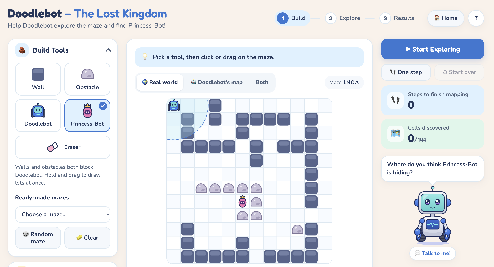 | 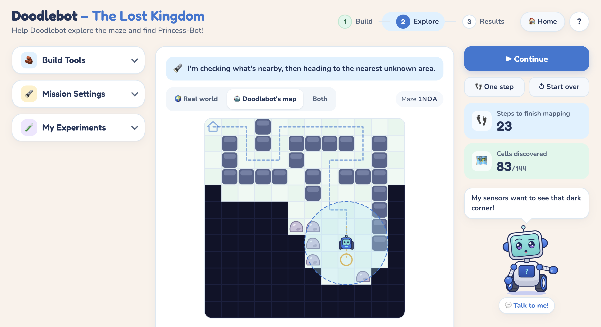 |
| Draw walls and obstacles, place Doodlebot and Princess-Bot, or load a ready-made maze. | Black squares are unknown. The circle is the sensor; the orange ring is the nearest unexplored area. |
| **3️⃣ Doodlebot plans** | **4️⃣ Compare the results** |
| 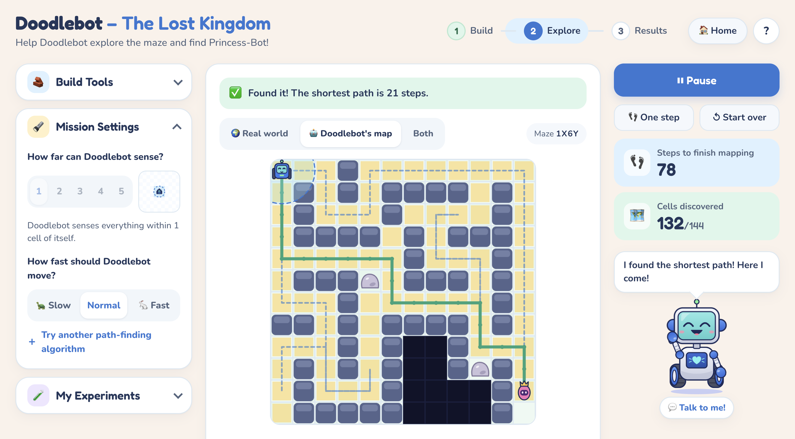 | 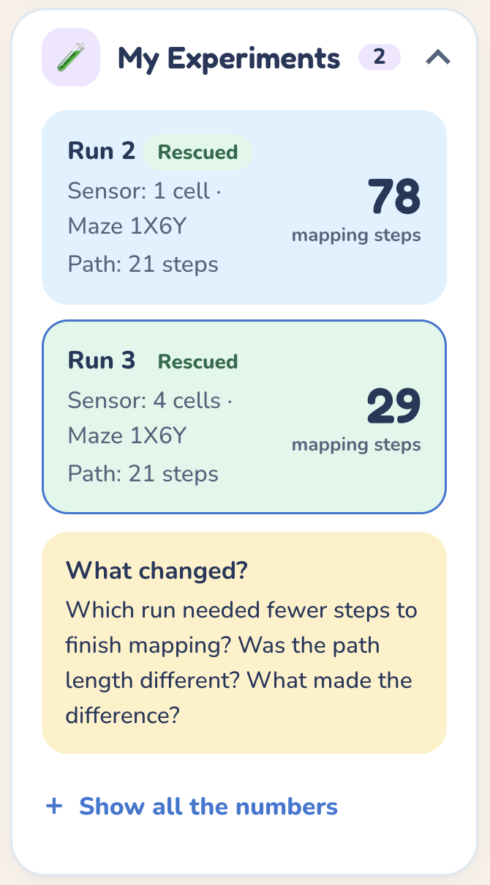 |
| Yellow squares show the search; the green line is the shortest path on **Doodlebot's own map**. | Change the sensor range, run the same maze again and see what changed. |

---

## 🚀 Run it locally

You need **Node.js 18 or newer** and **Google Chrome** (or Edge) for voice input. There are no packages to install.

```bash
npm start
```

Then open **http://localhost:3000** in Chrome.

<details>
<summary><b>🔑 Optional: connect a language model for Doodlebot's chat</b></summary>

<br>

The chat works **without any key**: Doodlebot answers from an offline script about sensing, maps and paths. For free-form answers:

1. Copy `.env.example` to `.env`.
2. Fill in **one** key: `ANTHROPIC_API_KEY` or `OPENAI_API_KEY` (any OpenAI-compatible endpoint works through `OPENAI_BASE_URL`).
3. Restart `npm start`. The terminal prints which chat mode is active.

🔒 The key is only read by the local server. It never reaches the browser, and `.env` is git-ignored.

**Voice:** with an OpenAI key, Doodlebot speaks with a natural OpenAI voice (`OPENAI_TTS_VOICE`, default `coral`). Without one, it uses the browser's voice automatically.

</details>

<details>
<summary><b>🧪 Run the tests</b></summary>

<br>

```bash
npm test
```

11 automated tests check the parts that are easy to get subtly wrong:

- the nearest frontier is chosen by **path distance**, not straight-line distance
- exploration stops only when **no reachable unknown cell** is left
- BFS and A\* both return a **true shortest path** on 60 random mazes, and A\* never searches more cells than BFS
- the odd mazes: enclosed start, walled-in Princess-Bot, empty grid, Princess-Bot next to the start
- the editor rules, and random mazes are always solvable

</details>

---

## 🕹️ How to play

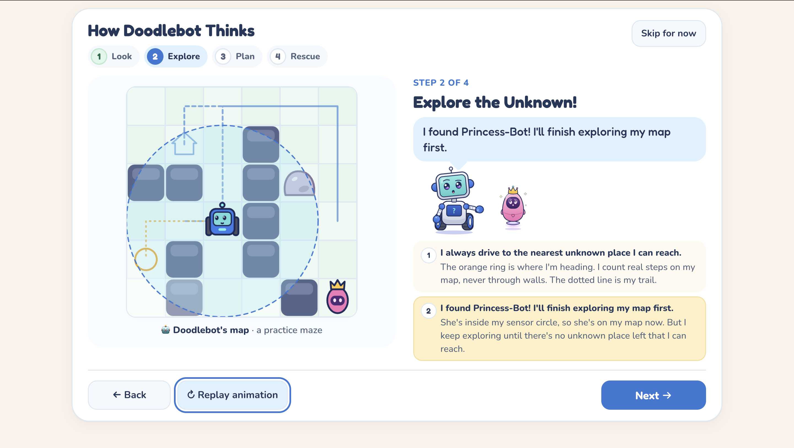

**Welcome → How Doodlebot Thinks → Game**

The game opens on a storybook welcome page. First-time players then see a four-step animated tutorial: **Look Around**, **Explore the Unknown**, **Think and Plan**, **Rescue or Try Again**. Every animation replays frames recorded from the real game code, so it never shows anything the game does not do. Students can skip it, and 🏠 **Home** pauses the game without losing progress.

The game itself has three stages, shown at the top of the page:

1. 🧱 **Build.** Open **Build Tools**, pick a tool (wall, obstacle, Doodlebot, Princess-Bot, eraser) and click or drag on the grid. Or load a ready-made maze, or press 🎲 for a random maze that always has a way through.
2. 🔍 **Explore.** Press **Start Exploring**. The centre switches to *Doodlebot's map*. Two live numbers show *steps to finish mapping* and *cells discovered*. **One step** moves one step at a time.
3. 🏆 **Results.** A results card shows the outcome, the sensor range, steps to finish mapping, the shortest path length and the cells searched, compared with the previous run on the same maze.

<br clear="right">

<details>
<summary><b>⚙️ Settings, experiments and other controls</b></summary>

<br>

- **Mission Settings** (closed by default): sensor range 1–5 with a picture of the sensing circle, speed (slow, normal, fast) and, under *Try another path-finding algorithm*, BFS (default) or A\*.
- **My Experiments** keeps every finished run as a card, asks *What changed?* once there are two runs, and has a full table of every number for the facilitator.
- The **map toggle** switches between the real world, Doodlebot's map, or both side by side.
- **What do the colours mean?** under the maze explains the overlays, and the **?** button opens a short how-to-play guide.

</details>

### 💬 Talk to Doodlebot

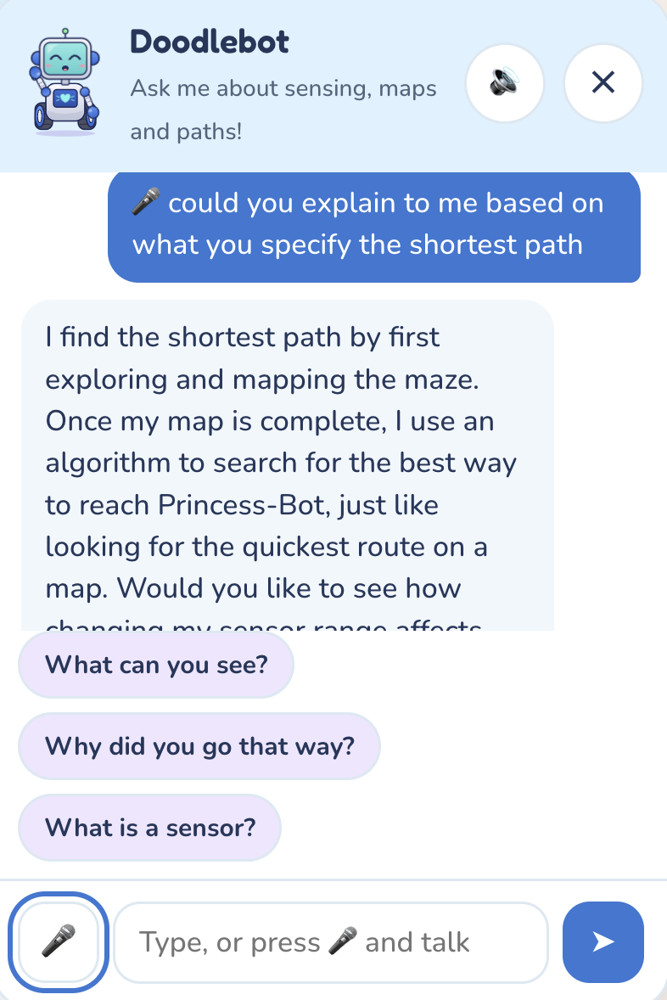

Click Doodlebot to open the chat. Students can **type** or press 🎤 and **speak**. Their speech is written into the chat as they talk, and Doodlebot's answer is shown and **read aloud** while its mouth moves.

Doodlebot's personality and rules live in [`prompts/doodlebot.md`](prompts/doodlebot.md), which is read on every message. The live game state (sensor range, current run, previous results) is sent with each question, so Doodlebot can talk about **this** maze with real numbers. Suggested questions help students who don't know what to ask, and 🔊 turns the voice off for quiet classrooms.

<br clear="right">

---

## 😊 Meet the characters

<div align="center">

|  |  |  |  |  |  |  |
|:---:|:---:|:---:|:---:|:---:|:---:|:---:|
| **Idle** | **Curious** | **Excited** | **Thinking** | **Happy** | **Sad** | **Princess-Bot** |
| Building the maze | Exploring | Princess-Bot sensed | Planning the path | Path found | No path | Waiting to be rescued |

</div>

Every emotion is tied to a real game event and shown three ways (face, chest screen and antenna colour), so children never rely on colour alone. An emotion controller keeps each face on screen for at least 1.2 s and gives important emotions priority, so a fast run never flickers. When Doodlebot reaches Princess-Bot, it celebrates with an **excited** dance and she switches to her rescued face.

Doodlebot is the hero of the story, in blue, setting out to rescue the princess in pink. Princess-Bot also has a **different shape** (a tall, floating, crowned egg), so children can tell the two apart at a glance, even on a small maze cell. More in [CHARACTER_DESIGN.md](CHARACTER_DESIGN.md).

---

## 🧭 How Doodlebot navigates

| Stage | What happens |
|---|---|
| 🟢 **Start** | Doodlebot knows only the grid size and its start cell, then senses once. |
| 📡 **Sensing** | Every step, every cell whose centre is within *range + 0.5* cells is copied from the real world onto Doodlebot's map (range 1 = the 3×3 square around it). The brief says it senses *every* cell within range, so the sensor sees through walls. |
| 🔍 **Exploring** | BFS from Doodlebot over cells it **knows** are free. The first *frontier* cell it reaches (a known free cell next to an unknown cell) is the nearest unexplored area **by path distance on its own map**. Doodlebot moves one step toward it, senses, and repeats. |
| 🛑 **Stopping** | Exploration ends when no reachable unknown cell is left. Cells sealed off by walls stay black. |
| ✨ **Finding Princess-Bot** | She is found the moment her cell enters the sensor range. Doodlebot still finishes the whole map first, because an unexplored square could hide a shorter way. |
| 🏠 **Returning** | Doodlebot drives back to its start along a shortest path on its finished map. |
| 🧠 **Planning** | BFS (default) or A\* (Manhattan heuristic) on Doodlebot's map only, **never** on the real map or through unknown cells. The yellow squares replay the planner's real search order. |
| 👑 **Rescue** | Doodlebot follows the path to Princess-Bot. If there is no path, or she was never sensed, Doodlebot says so and is sad. |

Ties are always broken in the same order (up, right, down, left), so **the same maze and settings always give the same run**. This is what makes the classroom experiment fair and repeatable.

<details>
<summary><b>📊 Metrics and the lesson experiment</b></summary>

<br>

| Metric | Meaning |
|---|---|
| Steps to finish mapping | Moves until no reachable unknown cell was left |
| Princess-Bot sensed at step | Exploration step when she entered the sensor range |
| Map known | Share of the grid on Doodlebot's map |
| Shortest path length | Moves on the planned path (or "no path") |
| Cells searched by planner | Cells the planner checked before reaching her |

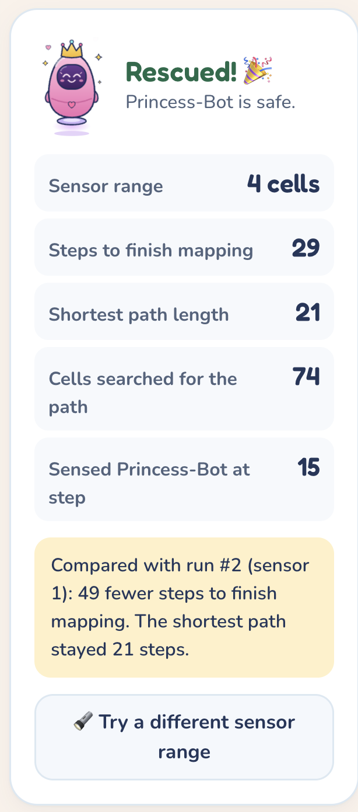

**On the Lesson maze (Maze ID `1X6Y`):**

| | Sensor 1 | Sensor 4 |
|---|:---:|:---:|
| Steps to finish mapping | **78** | **29** |
| Princess-Bot sensed at step | 24 | 15 |
| Shortest path | **21** | **21** |

A bigger sensor maps the maze much faster, but the shortest path stays the same, because the finished map is the same. For the same 21-step path, A\* searches **28** cells and BFS **74**.

<br clear="right">

</details>

<details>
<summary><b>🧩 Odd mazes</b></summary>

<br>

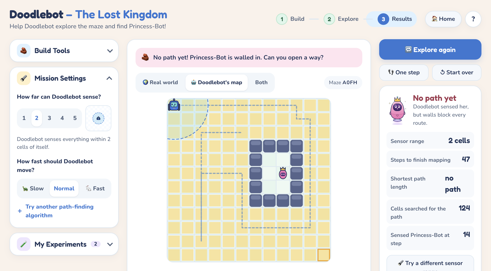

| Case | What happens |
|---|---|
| No start or no Princess-Bot | The run is blocked with a friendly message |
| Enclosed start | Exploration ends almost immediately; "never sensed" |
| Princess-Bot walled in | Sensed through the wall (range ≥ 2), the planner proves there is no path, Doodlebot is sad |
| Empty grid | Explores everything and rescues her |
| Princess-Bot next to the start | Sensed at step 0, path length 1 |

All of them are in the **Load a maze** menu.

<br clear="right">

</details>

---

## 📚 The Grade 5 lesson

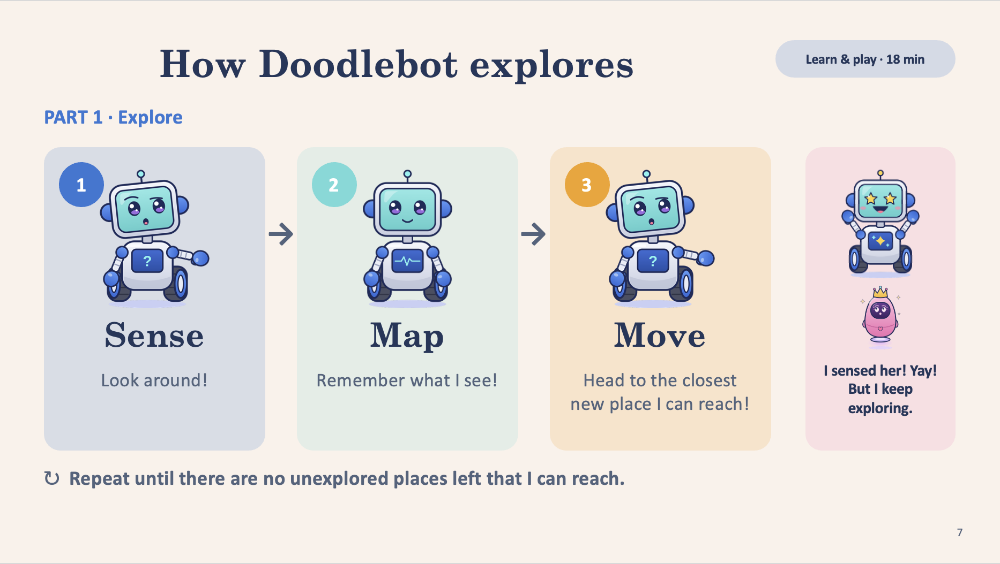

A 30-minute lesson built around **one fair experiment**: the same maze with sensor range 1, then 4.

| ⏱️ Segment | What happens |
|---|---|
| Warm-up (6 min) | *Mystery Map*: the class acts as Doodlebot's brain and can only see nearby squares |
| Concept and gameplay (18 min) | The tutorial, a prediction, then the experiment in pairs |
| Reflection (6 min) | Reflection questions and a voice question to Doodlebot |

<br clear="right">

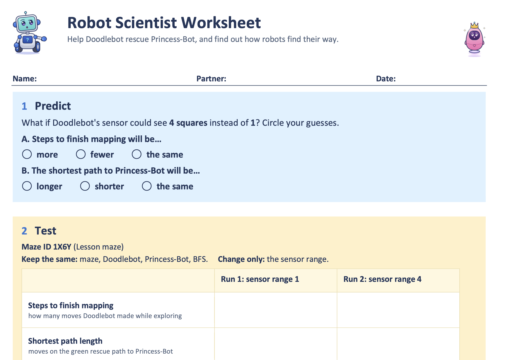

Most children expect a bigger sensor to give a shorter path. The results show **78 vs 29 steps to finish mapping, while the path stays 21**. Predicting first and then explaining the real numbers is the evidence of learning, recorded on the worksheet and judged with a simple rubric.

📄 [Lesson plan](curriculum/Doodlebot_Lesson_Plan.pdf) · 🖼️ [Slides](curriculum/Doodlebot_Lesson_Slides.pptx) · ✏️ [Worksheet](curriculum/Doodlebot_Student_Worksheet.pdf)

<br clear="left">

---

## ✅ Optional items attempted

- ☑️  **Deployed URL:** [doodlebot-navigator.onrender.com](https://doodlebot-navigator.onrender.com/#welcome) (offline chat mode; the first load may take ~50 s)
- ☑️  **Random solvable maze**, checked with BFS on the real map before it is shown
- ☑️  **Animated planner search**, replaying the planner's real search order
- ☑️  **Second path-planning algorithm**: A\* and BFS, compared by cells searched
- ☑️  **Results panel** keeping previous runs side by side, with a Maze ID for fair comparisons
- ☑️  **All emotions animated**: idle, curious, thinking, excited, happy, sad, plus a talking mouth synced to speech
- ☑️  **Story and tutorial**: a welcome page and an animated four-step "How Doodlebot Thinks"
- ☑️  **Engagement**: narration bubble, Princess-Bot's lost and rescued moods, a rescue celebration, a pencil-doodle trail
- ☑️  **Design files**: [`design/`](design) and [`public/characters/`](public/characters)
- ☑️  **Student worksheet**
- 🔜 Tele-operated mode
- 🔜 Movable obstacles, terrains, limited battery
- 🔜 Teacher guide

---

<details>
<summary><b>🗂️ Project structure</b></summary>

<br>

```
doodlebot-navigator/
├── server.js                  # local server: static files, /api/chat, /api/tts (keeps the key server-side)
├── package.json               # npm start · npm test
├── .env.example               # copy to .env and add one API key (optional)
├── README.md
├── CHARACTER_DESIGN.md        # how the characters and emotions were designed
│
├── prompts/
│   └── doodlebot.md           # Doodlebot's personality, answer rules and game facts
│
├── public/
│   ├── index.html             # the game page
│   ├── css/
│   │   └── style.css          # calm pastel theme, large targets, responsive, reduced-motion aware
│   ├── js/
│   │   ├── algorithms.js      # sensing, frontier search, BFS, A* (pure, tested)
│   │   ├── simulation.js      # the mission as a step-by-step generator
│   │   ├── world.js           # editor rules, random solvable mazes, ready-made mazes, Maze ID
│   │   ├── render.js          # canvas drawing of both maps
│   │   ├── main.js            # game controller, emotions, metrics, results
│   │   ├── app.js             # screens: welcome, tutorial, game; Home without losing progress
│   │   ├── tutorial.js        # animated "How Doodlebot Thinks" (replays real simulation frames)
│   │   ├── chat.js            # chat window, speech recognition, text-to-speech
│   │   └── offline-brain.js   # scripted answers when no API key is set
│   ├── characters/            # Doodlebot and Princess-Bot (SVG + CSS states, emotion controller)
│   └── assets/                # welcome-page artwork
│
├── test/
│   └── navigation.test.js     # 11 automated tests
│
├── design/                    # character sheet and emotion images
├── curriculum/                # lesson plan, slides, worksheet
├── docs/                      # design reflection and design report
└── imgs/                      # screenshots for this README
```

</details>


<details>
<summary><b>♿ Interface and accessibility</b></summary>

<br>

- One large map at a time, matched to the stage; menus stay closed until needed; one main button per stage.
- Pastel palette with dark navy text for contrast; unknown cells on Doodlebot's map stay black.
- Every button and option is at least 48 px tall; body text 17 px.
- Keyboard friendly: real buttons, arrow keys in option groups, visible focus rings, Escape closes the chat.
- Animations switch off under the system "reduce motion" setting.
- Works on desktop, tablet and phone widths.

</details>

<details>
<summary><b>⚠️ Known limitations</b></summary>

<br>

- **Exploration is greedy.** Each step, BFS finds the nearest unexplored area on Doodlebot's own map, and Doodlebot goes there, without planning the whole tour in advance. This is simple and fast, but not always the shortest possible tour, so a larger sensor range *usually* but not *always* means fewer mapping steps: on the Lesson maze, range 3 takes 54 steps, slightly more than range 2's 49. The rescue path itself is always a true shortest path (BFS or A\*).
- Voice input needs Chrome or Edge and an internet connection.
- The fonts load from Google Fonts; offline, the page falls back to a system font.
- On a small landscape tablet, students scroll once to reach the Start Exploring button.

</details>

---

## 🌱 Next steps

With more time, I would test the game with more children, and add a tele-operated mode so they can drive Doodlebot themselves and compare their steps with the robot's.

## 🙏 Credits

- Character style reference: the "Cute robot rocking out" vector illustration on [Magnific (Freepik)](https://www.magnific.com/premium-vector/cute-robot-rocking-out-cartoon-character-with-gesturing-hand_422239699.htm). ChatGPT generated the emotion variations, and the final characters were redrawn as layered SVGs.
- Built with the help of Claude as a coding partner. How I used AI tools and checked their work is described in the [design reflection](docs/Doodlebot_Design_Reflection.pdf).

<div align="center">

**Made with 🩷 for curious Grade 5 explorers, by Tala Alothaim**

</div>
